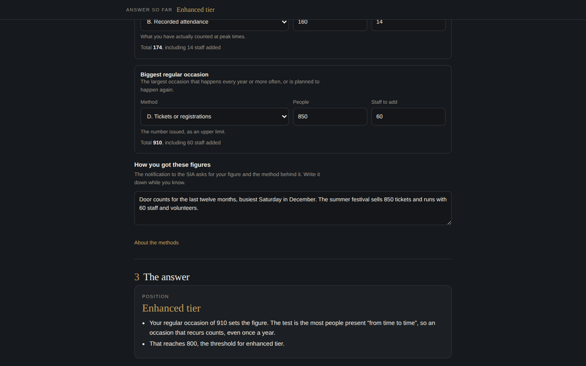

# Protection of Premises Readiness

**Is your venue or event covered, which tier is it in, and what can you decide now?**

**Open it here:** [adriaanbosch.net/protection-of-premises](https://adriaanbosch.net/protection-of-premises/protection-of-premises.html)

For the UK's Terrorism (Protection of Premises) Act 2025, often called Martyn's Law.

No install, no account, no subscription. Click the link and it runs in your browser. adriaanbosch.net hands you the tool; it never sees what you put into it. Everything you type stays in your browser, on your device.



---

## The problem it was built for

The Terrorism (Protection of Premises) Act 2025 puts new duties on venues and events across the UK. They are expected to start in spring 2027. The law is already written, so most of what a venue needs to decide can be decided now.

The first question looks simple: how many people? The Act sets two thresholds, 200 and 800. It does not say how to count. The Home Office guidance offers six methods, and they can give different answers for the same building. When the duties start, the notification to the Security Industry Authority asks for your figure and the method behind it, and giving the SIA false or misleading information is an offence.

So the count is a decision, and one you may be asked to defend. This tool helps you make it, see where it puts you, and record why.

## Who it is for

Anyone responsible for a venue or an event: a venue or facilities manager, a security manager, an event organiser, a consultant, or someone running a community building, a school or a place of worship. It needs no legal training and no specialist software.

## What it will not do

**It is not an official tool.** It is not Home Office or SIA guidance, and it is not legal advice.

**It works from the Act.** Where it draws on Home Office guidance instead, mainly on how to count people and what "reasonably practicable" means, it says so.

**It does not settle a dispute.** A tribunal can decide every question it answers: whether a site or event is covered, its tier, its main use, and who is responsible. The tool tells you where you appear to stand and why.

---

## How it works

### The site

Say whether you are checking a venue or an event. For a venue: is there a building, what is it mainly used for, does anything exclude it, is it part of a bigger site, and does it host bigger occasions than a normal busy day.

The main use is chosen, never assumed. It decides whether a tier override applies (places of worship, nurseries, schools and further education colleges stay in the standard tier at any size; universities and hospitals do not) and, for some uses, who the Act names as responsible.

### The count

Count the most people likely to be there at once, staff included, and only the people there for the public use. A venue is counted twice: its busiest normal period, and its biggest regular occasion. An occasion that comes round every year counts towards the venue's own tier, because the test is the most people present "from time to time". A pub that holds 174 on a busy night but has 910 there for its summer festival, staff included, is in the enhanced tier.

Each figure carries the method behind it, and there is a box for how you got there.

### The answer

The answer updates as you go and stays visible at the top of the page. When something is missing, it names the question and takes you to it. A one-off big occasion at a venue is checked separately, as a possible qualifying event in its own right.

### Who is responsible

Whoever controls the site for its public use. Owning the building or holding the licence does not settle it. Where the Act names the responsible person, for a school, a hospital or a university, the tool says so.

### The next 60 days

It then sets out the decisions you can take now, whatever the timetable does, by when: the first 30 days, days 31 to 60, and after that. Each one has a line to note what you decided.

### For reference: what the Act requires

The last section is reference rather than tool. It shows only the duties that apply to your tier, with the qualifier on each; some carry no reasonableness test at all, and it says which. It covers notifying the SIA and what enforcement can look like. It also names the places where the Act meets the law you already work to: your fire strategy, physical changes that may need consent, the Equality Act, and the plans you already have. The Act sits alongside that law and does not override it.

### The record

**Export the record** builds a Word document that opens in Word, Pages, Google Docs and LibreOffice. It carries the position and the reasons, the figures and their methods, who is responsible, the decisions with what was decided, and the duties for reference.

---

## Getting started

1. Open [the tool](https://adriaanbosch.net/protection-of-premises/protection-of-premises.html). There is nothing to install.
2. Work down the page. The answer at the top fills in as you go.
3. Write down how you got your figures. It is the part you will be asked for.
4. Note each decision as you take it, then press **Export the record**.
5. Bookmark the link, and come back to it in the same browser.

**Want to check it never sends your data anywhere?** Once the page has opened, switch off your Wi-Fi and carry on. It still works and still exports, because nothing in it needs the website to handle what you type.

---

## Your data

**The exported record is the record. The browser is a cache.**

What you enter is kept in the browser you used, on the device you used. A private window forgets it when you close it, and clearing your browser's data for adriaanbosch.net clears it too. Export the record whenever it matters.

## Privacy, and how to check it rather than trust it

There are no network calls of any kind. No analytics, no telemetry, no fonts, no sync, no sign-in.

You do not have to take that on faith. With the tool open, right-click the page, choose **View Page Source**, and search for these three:

```
fetch(          XMLHttpRequest          WebSocket
```

Those are the ways a web page asks the internet for something. There are none of them in here.

Search for `http` as well and you will find eleven. Nine are links to the Act, the regulations and the official guidance, one of them used twice. One is the link to the other tools on adriaanbosch.net. You would have to click any of those for it to open. The last is a fixed label that every Word file carries inside it, written when the tool builds the record. None of them loads anything.

The published page is a compacted copy of the readable master: comments and spacing are removed, and every name is left as written, so the source stays readable enough to check.

---

## Keeping it current

The page shows the date its facts were last checked. If it has not been updated by the end of January 2027, it says so at the top and points you to the SIA's page for the latest. The tool is updated when the SIA publishes its guidance on how it will regulate, or when a start date is set.

## Requirements

A browser, and a connection to open the page. Once it is open it keeps working without one. It works on a phone, and is easiest on a laptop or desktop.

## Sources

Checked on 3 October 2026.

- [Terrorism (Protection of Premises) Act 2025](https://www.legislation.gov.uk/ukpga/2025/10/contents)
- [The Terrorism (Protection of Premises) (Notification Requirements) Regulations 2026](https://www.legislation.gov.uk/uksi/2026/793/made)
- [The Terrorism (Protection of Premises) (Principal Use of Premises) Regulations 2026](https://www.legislation.gov.uk/uksi/2026/1005/made)
- [Statutory guidance, Home Office](https://www.gov.uk/government/publications/the-terrorism-protection-of-premises-act-2025/terrorism-protection-of-premises-act-2025-statutory-guidance), with its supplementary documents on [counting methods](https://www.gov.uk/government/publications/the-terrorism-protection-of-premises-act-2025/non-statutory-supplementary-document-a-methods-for-assessing-the-reasonable-expectation-of-individuals-present-at-the-premises-and-events-accessible) and [scope examples](https://www.gov.uk/government/publications/the-terrorism-protection-of-premises-act-2025/non-statutory-supplementary-document-b-scope-illustrative-examples-accessible)
- [Understanding Martyn's Law and the SIA's role as regulator](https://www.gov.uk/guidance/understanding-martyns-law-and-the-sias-role-as-regulator)
- [ProtectUK](https://www.protectuk.police.uk/martyns-law)

Before release, the tool was checked against the worked scope examples in the Home Office guidance and gave the same answer for each.

Contains public sector information licensed under the [Open Government Licence v3.0](https://www.nationalarchives.gov.uk/doc/open-government-licence/version/3/). The tool is written in its own words. It is not produced or endorsed by the Home Office, the Security Industry Authority or ProtectUK.

## More tools

Protection of Premises Readiness is one of a set of security tools that work the same way. [See the others](https://adriaanbosch.net/#tools).

## Licence

MIT.
